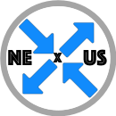

# Nexus Overview

**WAMP Router Library, Client Library, and Router Service**

## Why Nexus - another WAMP implementation

Go as a language and an ecosystem is popular for building distributed systems, web, and micro-service infrastructure.
These often have a need for publish-subscribe (pub-sub) and remote procedure call (RPC) communications.
The WAMP protocol provides both with a robust set of options for how they operate.
Nexus provides a full-featured Go implementation of WAMP, supplying both router and client libraries.
Nexus strives to be reliable, have good performance characteristics, and provide easily usable APIs.

## Features Easily Accessible

The programming libraries included are intended to be simple to use while allowing the developer to take full advantage of the WAMP advanced profile features provided.
Extended functionality in the Meta API and in publication filtering offers enhanced support for a client to make decisions about message recipients.

## Different Transport Options

Various transport and message encoding options are available.
This includes a special transport specifically for nexus clients embedded in the same application as a nexus router, that allows the clients to communicate directly with the router in-process, without any interprocess communication or message encoding overhead.

# Package Components

The nexus project provides a WAMP router library, client library, and stand-alone WAMP router service.
These components can be used together to facilitate communication in distributed systems, or can be used independently to interoperate with other WAMP client or router implementations.
Using a nexus client with a nexus router allows all nexus features and functionality to be fully utilized.

## Router Library

The router library can be used to build custom WAMP routers or to embed a WAMP router in an application.
The router code is located in the `router/` directory of this project, and is imported into your project by `import "github.com/gammazero/nexus/v3/router"`.
See [Creating a WAMP router with nexus](router-example.md) for a walk-through of creating a WAMP server that can be part of your application.

## Client Library

The client library can be used to build clients that connect to any WAMP server, or to communicate in-process with a WAMP router embedded in the same application.
The client code is located in the `client/` directory of this project, and is imported into your code by `import "github.com/gammazero/nexus/v3/client"`.
See [Creating an Example Subscriber Client](client-subscriber-example.md) for a walk-through of creating a simple client.
See the [pub/sub client examples](../examples/pubsub) for examples of subscribe and publish clients, and the [rpc client examples](../examples/rpc) for examples of [caller](../examples/rpc/caller/caller.go) and [callee](../examples/rpc/callee/callee.go) clients.

The [server example](../examples/server/server.go) also includes a callee client embedded in the server application, which uses in-process communication to the router.
Embedding a client in the same application as the router is how an application can itself provide functionality via the router's pub/sub and RPC facilities.

## Router Service

The router service can be run as-is to provide WAMP routing.
This is useful when you need a general-purpose WAMP router without having to write any code to provide one.
The service code is located in the [cmd/nexusd/](../cmd/nexusd) directory of this project.
It is built by running `make` in this project, or by building it directly using `go build`.
See [Getting Started](getting-started.md) for how to build, configure and run it.
